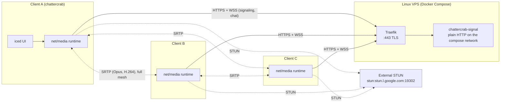
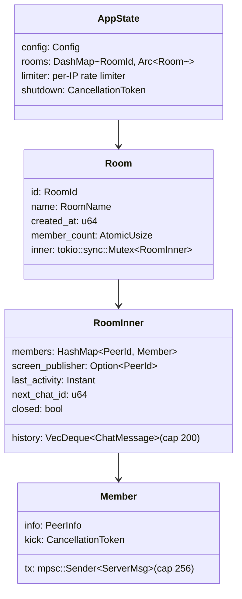
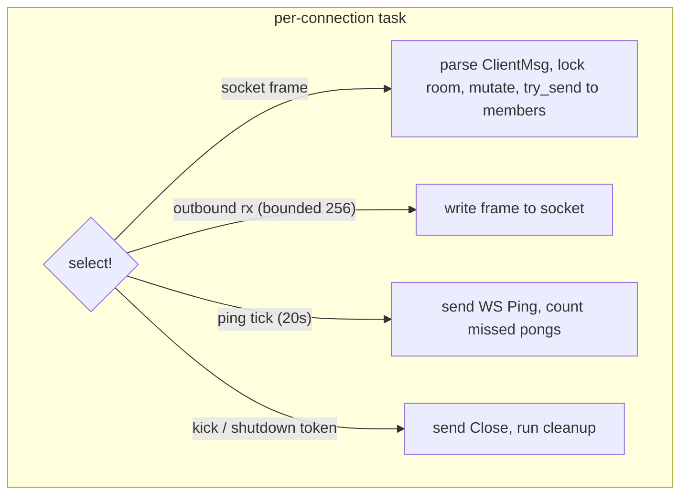
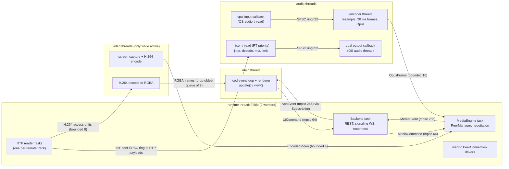
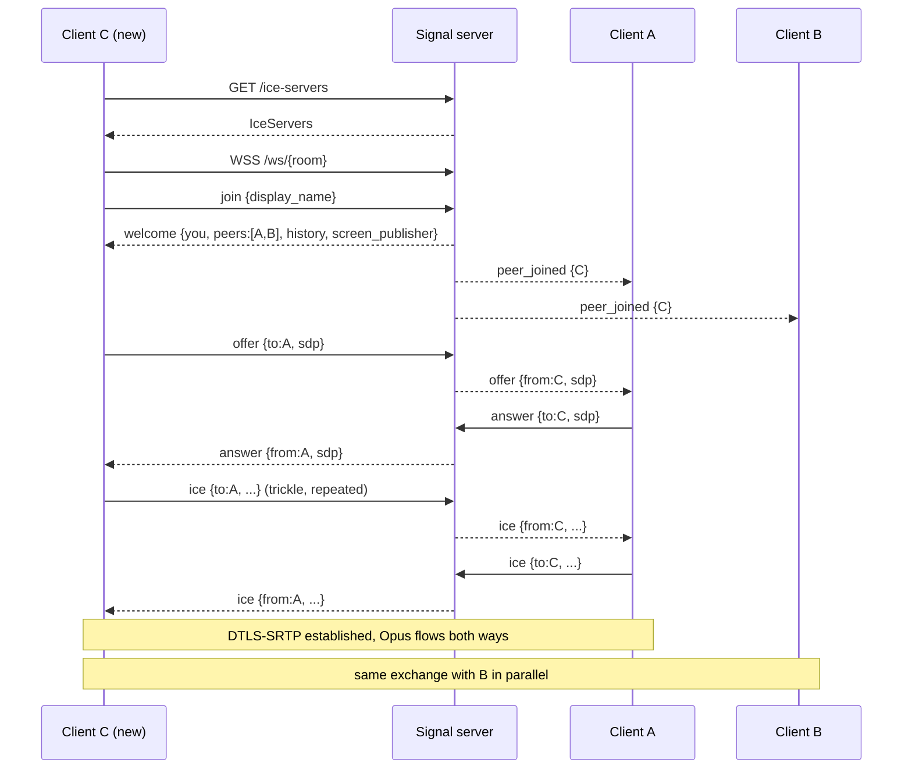
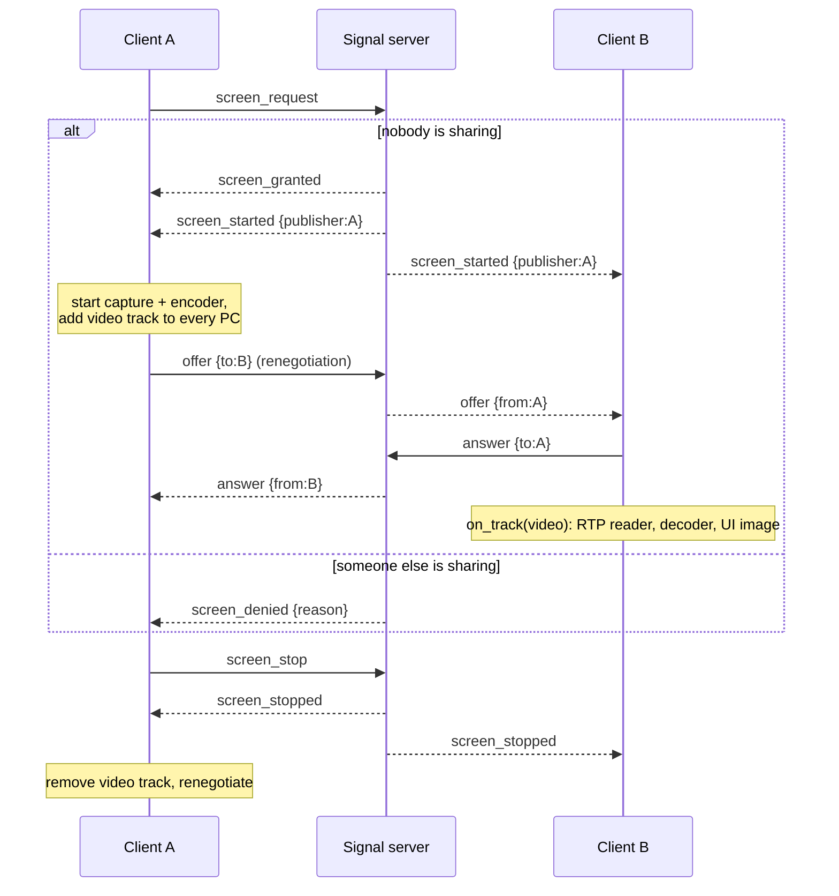

# Chattercrab Architecture

Chattercrab is a minimalist peer-to-peer voice, text and screen-share application.
Everything is written in Rust. A small signaling server coordinates rooms and relays
SDP/ICE messages and chat; all audio and video flows directly between peers over
WebRTC. On a VPS, Traefik terminates TLS and proxies to `chattercrab-signal`, which
speaks plain HTTP on the Compose network. Clients use an external STUN server for
server-reflexive candidates. Media is direct peer-to-peer. Peers that cannot establish
a direct path do not get a relay. The signaling server never touches media.

## 1. Components



| Crate                  | Kind                        | Responsibility                                                                                                                             |
| ---------------------- | --------------------------- | ------------------------------------------------------------------------------------------------------------------------------------------ |
| `chattercrab-protocol` | library                     | Shared serde types for REST and WebSocket messages. Validation newtypes. No I/O.                                                           |
| `chattercrab-server`   | binary `chattercrab-signal` | Rooms, membership, signaling relay, chat history, screen-share arbitration. Clients receive one external STUN URL from `GET /ice-servers`. |
| `chattercrab-media`    | library                     | Audio capture/encode, jitter buffers, mixer, playback, screen capture/encode/decode, WebRTC peer management. Message-based API.            |
| `chattercrab-client`   | binary `chattercrab`        | iced desktop UI, configuration, signaling client, reconnect logic. Drives `chattercrab-media` through commands and events.                 |

Dependency graph: `client -> media -> protocol`, `client -> protocol`, `server -> protocol`.
The server never depends on the media crate, which keeps the server binary small and
free of native audio/video libraries.

## 2. Topology and scale

- Full mesh: with `N` participants each client maintains `N - 1` peer connections.
  The design target is 4 to 5 participants per room (`CHATTERCRAB_MAX_ROOM_SIZE`, default 5).
- Upstream cost per client: `(N - 1) x 96 kbps` of Opus, plus `(N - 1) x ~1.5 Mbps` while
  that client is the screen publisher. With 5 participants a publisher needs about 6 Mbps up.
- At most one screen publisher per room. The server is the arbiter (section 5.3), which
  keeps the mesh upstream bounded and the UI simple.

## 3. Signaling server

When `CHATTERCRAB_PASSWORD` is set, the signaling server requires a shared HTTP Basic
credential on every route except `GET /health` and CORS preflight. `GET /health` stays
open. Peers still exchange media directly; the password only guards signaling.

### 3.1 State



- There is no global lock. The `DashMap` shards protect the room index; each room has its
  own `tokio::sync::Mutex`. A `DashMap` guard is never held across an `.await`: handlers
  clone the `Arc<Room>` out and drop the guard immediately.
- `member_count` mirrors `members.len()` so `GET /rooms` never takes a room lock.
- When the last member leaves, the room is marked `closed` under its lock and removed
  from the index with `remove_if(Arc::ptr_eq)`. A join that raced with the deletion sees
  `closed == true` and is rejected with `room_not_found`.

### 3.2 Connection task

Each WebSocket is served by a single task that owns the socket and runs one `select!` loop:



- Broadcasts use `try_send` while holding the room lock, so a slow socket can never stall
  a room. If a member's queue is full the broadcaster cancels that member's `kick` token;
  the member's own task then performs the normal disconnect cleanup. Cleanup never runs
  re-entrantly inside another member's broadcast.
- A connection that sends nothing but `Join` within 5 seconds is closed.
- Heartbeat: a WebSocket Ping every 20 seconds; after two consecutive missed Pongs the
  socket is closed.
- Disconnect cleanup: remove the member, broadcast `peer_left`, release the screen lock
  (broadcasting `screen_stopped`) if the leaver was publishing, delete the room if empty.

### 3.3 Background tasks and signals

| Trigger            | Action                                                                                                                      |
| ------------------ | --------------------------------------------------------------------------------------------------------------------------- |
| every 60 s         | Evict rooms with no members whose `last_activity` is older than `CHATTERCRAB_ROOM_IDLE_TTL_SECS`. Prune rate-limiter state. |
| `SIGHUP`           | Re-read certificate and key, build a new rustls `ServerConfig`, swap it atomically. Existing TLS sessions are untouched.    |
| `SIGTERM` / Ctrl+C | Stop accepting, cancel the shutdown token (every socket gets a Close frame `1001`), wait at most 10 s, exit.                |

The server is a single static musl binary. Logs are JSON lines on stdout, which journald
captures with timestamps and the unit name.

## 4. Client runtime and threading model



Rules:

- `update()` in the UI never blocks. Every action is a message to the Backend.
- The UI never calls webrtc or cpal. It sends `UiCommand`s; the Backend forwards media
  related ones as `MediaCommand`s and receives `MediaEvent`s.
- Every channel is bounded. Producers on real-time threads use `try_send`/`try_push` and
  drop on overflow (counted, logged at a rate limit) instead of blocking.
- CPU-heavy codec work (Opus encode, H.264 encode/decode, decode/mix) runs on dedicated
  OS threads, never on Tokio workers.
- The real-time callbacks and the mixer loop do not allocate: all buffers are allocated
  when a stream or peer is set up. The cpal callbacks never lock a mutex.

## 5. Message flows

### 5.1 Join and mesh setup

The newcomer offers to every existing peer. Existing peers create their side of the
connection when the first offer arrives. Perfect negotiation (section 6) covers any later
glare, for example both sides renegotiating at once for screen share.



### 5.2 Chat

`chat {text}` is validated (1 to 2000 characters after trimming), stamped with a per-room
id, the sender and the server time, appended to the 200-entry history ring and broadcast
to every member, including the sender (the echo is the delivery confirmation).
History lives only in server memory and in the client's in-memory view. Nothing is
written to disk on either side.

### 5.3 Screen share



If the publisher disconnects, the server releases the lock and broadcasts
`screen_stopped` itself. Receivers send PLI when they start decoding or detect loss;
the publisher forces an IDR frame on any PLI or FIR.

### 5.4 Reconnect

On a WebSocket drop the client tears down all peer connections, keeps the audio devices
open, and retries the join with exponential backoff (1, 2, 4, 8, 16, 30, 30 ... seconds).
A fresh `welcome` yields a new `PeerId`; the mesh is rebuilt exactly as in 5.1. If the
room no longer exists the client returns to the lobby with a notice.

## 6. Media pipeline

### 6.1 Send path (audio)

```text
cpal input callback (device rate, N ch, any sample format)
  -> downmix to mono f32                      (no alloc, no lock)
  -> SPSC ring (ringbuf, 500 ms capacity)
encoder thread
  -> rubato resampler to 48 kHz if needed     (preallocated buffers)
  -> accumulate 960-sample (20 ms) frames
  -> mute: frame replaced by zeros (Opus DTX makes it ~1 byte)
  -> RMS for the local speaking indicator     (atomic store)
  -> Opus encode: VoIP, 96 kbps, DTX, in-band FEC, complexity 5
  -> OpusFrame (fixed array + len) -> bounded channel (try_send)
MediaEngine
  -> wrap the frame once in refcounted Bytes and write it to each connection's
     Opus TrackLocalStaticSample (encode once, packetize per connection)
```

### 6.2 Receive path (audio)

```text
on_track(audio) -> RTP reader task per peer
  -> RtpAudioPacket {seq, ts, payload} -> per-peer SPSC ring (64 packets)
mixer thread, every 20 ms (paced by output ring fill level)
  for each peer slot (preallocated, max 8):
     drain ring into the jitter buffer (adaptive target 40 ms, max 120 ms)
     pop: packet -> decode | next packet present -> FEC decode | else -> PLC
     RMS -> per-peer level atomic
     sample * volume (0.0 .. 2.0) accumulated into i32
  soft-knee limiter -> i16 -> f32
  rubato 48 kHz -> device rate if needed
  -> SPSC ring -> cpal output callback (mono duplicated to every channel)
deafen: the mixer still drains and decodes (to keep jitter state warm) but writes silence
```

The mixer measures each iteration; if one exceeds 20 ms it logs a rate-limited warning.

### 6.3 Screen share

```text
publisher: capture thread
  xcap (monitor or window) -> RGBA
  -> fast_image_resize to fit 2560x1440 (1440p) or 1920x1080 (1080p), never scaled up
  -> hardware H.264 (Windows Media Foundation, Linux VA-API), otherwise OpenH264
  -> Annex-B access unit + duration -> bounded channel -> H.264 TrackLocalStaticSample
receiver:
  on_track(video) -> RTP reader -> H.264 depacketizer -> access unit
  -> decoder thread (openh264) -> RGBA frame -> drop-oldest queue (capacity 2) -> UI image
```

Frame rate defaults to 60 fps with the 1440p cap. Other rates from 5 to 60 remain selectable, and high quality adds 120 fps. The share picker also asks for desktop mode (crisp fonts) or game mode (less blur on moving images). That choice does not change the resolution or frame rate. On Windows and Linux the picture is encoded by the GPU's H.264 encoder when one is registered. High quality uses H.264 High at the fixed bitrate on both.

### 6.4 Peer management and negotiation

`PeerManager` owns one webrtc `PeerConnection` per remote peer, keyed by `PeerId`.

- Perfect negotiation: the peer with the lexicographically smaller `PeerId` is
  **impolite**, the other is **polite**. On an incoming offer that collides with a local
  offer in flight, the impolite peer ignores it and the polite peer rolls back and
  answers. The decision logic lives in a pure state machine (`peer::negotiation`) that is
  unit tested against a fake signaling channel, separate from the webrtc plumbing.
- Configuration: `MaxBundle`, `rtcp-mux` required, ICE servers from `IceServers` (one `stun:` URL, empty username and credential),
  disconnected timeout 5 s, failed timeout 15 s, UDP and TCP candidates only (IPv4 host
  candidates, no mDNS).
- Tracks: audio is encoded once and the same buffer is written to one Opus local track
  per connection (webrtc 0.21 binds a local track to a single connection, ADR-201).
  While sharing, an H.264 track is added to every connection (renegotiation) and removed
  on stop; the H.264 stream is likewise encoded once.
- webrtc 0.21 does not wake its connection driver when tracks or remote candidates
  change, so the peer manager writes one Opus silence frame to nudge it (ADR-212);
  media is only sent to a peer once its connection is `Connected`.

## 7. Failure handling summary

| Failure                      | Behavior                                                                                                                              |
| ---------------------------- | ------------------------------------------------------------------------------------------------------------------------------------- |
| Slow signaling consumer      | Queue (256) full: server kicks the member; others get `peer_left`.                                                                    |
| Client dead without TCP FIN  | Two missed WS pongs (about 40 s) and the server cleans up.                                                                            |
| Signaling WS drops on client | Backoff reconnect, mesh rebuilt from the new `welcome`.                                                                               |
| ICE failure with one peer    | The impolite side performs an ICE restart (up to 2 attempts, counter reset on `Connected`); the UI shows the peer's connection state. |
| Audio device unplugged       | Stream error event; UI shows it, user can reselect a device.                                                                          |
| Server restart               | Clients reconnect; rooms are in-memory and must be recreated if empty.                                                                |
